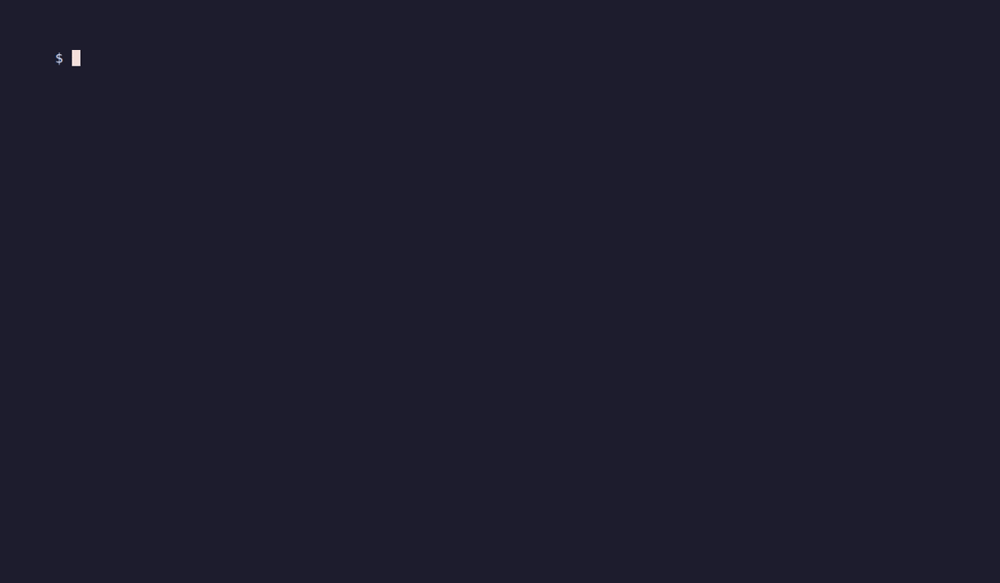

# babelgate

A small proxy that sits in front of LLM APIs and translates between their
request/response formats — streaming and tool calls included. Point your
OpenAI client at it, and it can talk to Gemini, Ollama, or Anthropic behind
the scenes — and vice versa. Point Claude Code at it, and it runs on any
tool-capable model you can reach.

Supported providers right now:

- OpenAI (and OpenAI-compatible backends like OpenRouter)
- Google Gemini
- Ollama
- Anthropic (Claude)


*Recorded with [scripts/demo](scripts/demo/); the model's thinking time is cut.*

## Quick start: Claude Code on a local model

```bash
ollama pull qwen3-coder:30b
OLLAMA_API_BASE_URL=http://localhost:11434 \
  npx babelgate --preset claude-code --target ollama --model qwen3-coder:30b
```

babelgate prints the two lines Claude Code needs:

```
export ANTHROPIC_BASE_URL=http://localhost:3000
export ANTHROPIC_AUTH_TOKEN=babelgate
```

Export them in your shell, then:

```bash
claude
```

Claude Code talks Anthropic format to babelgate; babelgate streams it to
Ollama — tools included. Two honest caveats on this exact path: the release
gate passed on hosted OpenRouter models, not on local `qwen3-coder:30b`, and
small local models call tools unreliably — see
[Known limitations](#known-limitations).

### Claude Code on OpenRouter (or any OpenAI-compatible backend)

```bash
OPENAI_API_KEY=<your OpenRouter key> \
  npx babelgate --preset claude-code --target openai \
  --model qwen/qwen3-coder --base-url https://openrouter.ai/api
```

The base URL is `https://openrouter.ai/api` — babelgate appends
`/v1/chat/completions` itself. If your OpenRouter key has a spend limit,
cap Claude Code's output budget or requests can be rejected:

```bash
export CLAUDE_CODE_MAX_OUTPUT_TOKENS=8000
```

Then the same two `export` lines and `claude`. Full walkthrough:
[docs/recipes/claude-code.md](docs/recipes/claude-code.md).

### Any OpenAI-SDK app on any backend

```bash
OLLAMA_API_BASE_URL=http://localhost:11434 \
  npx babelgate --preset openai-apps --target ollama
```

prints:

```
export OPENAI_BASE_URL=http://localhost:3000/v1
export OPENAI_API_KEY=babelgate
```

The app sends whatever model name it likes — it's forwarded to the target
unchanged (send a name the target knows, like `qwen3-coder:30b`, or rename
with `MODEL_MAP`). Recipe: [docs/recipes/openai-sdk.md](docs/recipes/openai-sdk.md).

### Recommended tool-capable models

- **Verified through the release gate** (Claude Code completed a real edit
  task through babelgate): `qwen/qwen3-coder` and `poolside/laguna-s-2.1:free`
  on OpenRouter.
- **Local (Ollama):** `qwen3-coder:30b` is the intended launch model — it
  needs serious RAM or a GPU. Smaller `qwen2.5-coder` sizes run on CPU but
  are slow and call tools less reliably.

## The `babelgate` CLI

`npx babelgate` parses flags with `node:util`, sets environment defaults
that **your own env always overrides** (a stderr line,
`babelgate: your environment overrides <keys>`, tells you which preset
values lost), starts the server, and prints the client `export` lines to
paste. Upstream API keys come only from the environment — never from flags.

```
Usage: babelgate [--preset <claude-code|openai-apps>] [--target <provider>]
                 [--model <name>] [--base-url <url>] [--port <n>] [--help]

Upstream API keys come only from the environment
(OPENAI_API_KEY, ANTHROPIC_API_KEY, GEMINI_API_KEY, OLLAMA_API_KEY).
```

| Flag          | Effect                                                                        |
| ------------- | ----------------------------------------------------------------------------- |
| `--preset`    | `claude-code` (source `anthropic`) or `openai-apps` (source `openai`)           |
| `--target`    | `ollama`, `openai`, `anthropic` or `gemini` — sets `TARGET_API`                 |
| `--model`     | `claude-code` preset only: `MODEL_MAP=claude-*=<model>`                         |
| `--base-url`  | Sets `{TARGET}_API_BASE_URL` (e.g. `https://openrouter.ai/api` for OpenRouter)  |
| `--port`      | Listen port (default `3000`)                                                    |
| `--help`      | Usage                                                                         |

The `claude-code` preset also sets `TARGET_CONTEXT_WINDOW=32768` and, for
`--target ollama`, `UPSTREAM_TIMEOUT_MS=600000` — local models are slow.
Without `--model` it warns `babelgate: no --model given; claude-* model
names are forwarded to the target unchanged` on stderr.

Presets are just env values. Everything below works without them.

## How it works

The naive way to build this is a transformer per provider pair. That gets
painful fast — four providers means twelve conversion functions in each
direction, and every new provider adds another batch.

Instead, every request goes through a **canonical format** in the middle:

```
OpenAI request ──► canonical ──► Gemini request
Gemini response ──► canonical ──► OpenAI response
```

Each provider has an _adapter_ that knows how to convert its own format to and
from canonical. Adding a provider costs you one adapter file — the rest of the
pipeline doesn't care.

The actual request flow:

1. Request hits the Express app.
2. If the path matches the configured source provider's API prefix
   (e.g. `/v1/chat/completions` for OpenAI), the proxy takes it.
   Otherwise it falls through to a 404.
3. The body is converted to canonical, then from canonical to the target
   format.
4. It's forwarded upstream to `{TARGET}_API_BASE_URL` + the target's
   endpoint, with the right auth headers.
5. The response comes back through the same path in reverse.

Endpoint kinds:

- **Chat** — the request/response translation described above (OpenAI
  `/v1/chat/completions`, Gemini `/v1beta/models/{m}:generateContent`,
  Ollama `/api/chat`, Anthropic `/v1/messages`).
- **Streaming chat** — `stream: true` (and Gemini's
  `:streamGenerateContent?alt=sse`) flows chunk-by-chunk in each side's own
  wire protocol: SSE for OpenAI, Anthropic and Gemini, NDJSON for Ollama.
  A client disconnect aborts the upstream request; an upstream that dies
  mid-stream produces an in-stream error in the client's dialect, and a
  stream that stalls longer than `UPSTREAM_STREAM_IDLE_MS` is cut rather
  than left hanging.
- **Tools** — tool definitions, `tool_choice`, parallel calls, streamed
  tool-call deltas and tool results map through canonical. Calls with
  arguments that aren't valid JSON reach the model wrapped as
  `{ "_invalid_arguments": "<raw>" }` instead of crashing the turn.
- **Model list** — GET endpoints (`/v1/models`, `/v1beta/models`,
  `/api/tags`) transform the upstream catalog into the source format,
  so client SDKs and dropdowns work unchanged.
- **`count_tokens`** (Anthropic source only) — answered locally as a
  chars/4 estimate, marked by the `x-babelgate-token-estimate: true`
  response header. Claude Code calls it constantly; the estimate keeps
  it happy without a fake upstream.

Every completed chat request logs token usage (`inputTokens`,
`outputTokens`, `finishReason`, upstream latency) via pino — grep for
`"Request completed"`. Model-list requests log `modelCount` instead
(`"Models list completed"`).

## Configuration

Everything is environment variables. One instance serves one source→target
pair; run multiple instances for more.

| Variable                  | What it's for                                                                                |
| ------------------------- | -------------------------------------------------------------------------------------------- |
| `SOURCE_API`              | Format clients send to you — `openai`, `gemini`, `ollama`, or `anthropic`                    |
| `TARGET_API`              | Format to translate to upstream — same options                                               |
| `PORT`                    | Listen port (default `3000`)                                                                 |
| `{PROVIDER}_API_BASE_URL` | Upstream base URL for the target provider, e.g. `OLLAMA_API_BASE_URL=http://localhost:11434` |
| `{PROVIDER}_API_KEY`      | API key for the target provider (Ollama doesn't need one)                                    |
| `UPSTREAM_TIMEOUT_MS`     | Per-request upstream timeout (default `30000`)                                               |
| `UPSTREAM_RETRIES`        | Retries for transport failures / 429 / 503 (default `1`)                                     |
| `UPSTREAM_STREAM_IDLE_MS` | Longest gap allowed between chunks mid-stream (default `300000`)                             |
| `MAX_BODY_SIZE`           | JSON body limit (default `10mb` — base64 images need it)                                     |
| `PROXY_API_KEY`           | Optional client auth — when set, callers send the key in their provider's native auth header (see Authentication) |
| `MODEL_MAP`               | Ordered `glob=model` rules, comma-separated — e.g. `claude-*haiku*=qwen2.5-coder:7b,claude-*=qwen3-coder:30b`. First match wins; replies still carry the name the client asked for |
| `TARGET_CONTEXT_WINDOW`   | Minimum context window the target should allocate (Ollama `options.num_ctx`)                  |

Routing and upstream endpoints are conventions, not configuration: each
provider's routes (`kind`, `method`, `pathPrefix`, `requestPath`) live in
`PROVIDER_ROUTES` in `src/transformers/adapters/index.ts`.

## Authentication

Set `PROXY_API_KEY` and every proxied endpoint requires it, in whichever
native auth style the client SDK already sends — any one match
authenticates, and every comparison is timing-safe:

- `Authorization: Bearer <key>` — OpenAI and Ollama SDKs, Anthropic's
  `ANTHROPIC_AUTH_TOKEN` (the `Bearer` scheme is case-insensitive)
- `x-api-key: <key>` — Anthropic SDK
- `x-goog-api-key: <key>` — Gemini SDK
- `?key=<key>` query parameter — Gemini's other auth style

A wrong or missing key gets a `401` in the source provider's error format.
The client key is never forwarded upstream — the upstream sees only the
proxy's own `{TARGET}_API_KEY`. Leave `PROXY_API_KEY` unset to disable
client auth (local dev — the CLI's printed `export …_TOKEN=babelgate`
lines are placeholders in that mode), and note `/health` stays open either
way.

## Errors

Errors on provider routes are rendered in the **source** provider's error
format, so client SDKs raise their native exceptions:

| Source | Error body |
|---|---|
| OpenAI | `{"error":{"message","type","param","code"}}` |
| Anthropic | `{"type":"error","error":{"type","message"}}` |
| Gemini | `{"error":{"code","message","status"}}` |
| Ollama | `{"error":"<message>"}` |

The same holds inside a stream: an upstream that fails mid-stream produces
the source dialect's in-stream error event, never silence or half a JSON
object.

When the upstream provider itself fails, the status the client sees is:

| Upstream | Client | Notes |
|---|---|---|
| 400, 422 | 400 | The upstream message passes through |
| 404 | 404 | Almost always "model not found" — the client can fix it |
| 413 | 413 | Request too large |
| 429 | 429 | `Retry-After` passed through when present |
| 401, 403 | 502 | `Upstream <provider> rejected the proxy's credentials (<status>)` — the *proxy's* upstream key failed, not the client's. Gemini's `400 API_KEY_INVALID` maps here too |
| 503, 529 | 503 | Unavailable |
| Other 5xx | 502 | Upstream failure |
| Timeout | 504 | After `UPSTREAM_TIMEOUT_MS` |
| Transport failure | 502 | Upstream unreachable |
| Non-JSON 2xx body | 502 | `Upstream returned a non-JSON response (content-type: <type>)` |

Error privacy in detail: proxy-generated messages contain no prompt text
or API keys, and client credentials are redacted from request logs. An
upstream 401/403 — including Gemini's `400 API_KEY_INVALID` — reaches
neither the client nor the logs; every other upstream error message is
passed through to the client and logged truncated to 200 characters.
Outside production, an error's `details` may include the first 200
characters of a non-JSON upstream body. Unknown paths and `/health` keep
a small generic error shape rather than any provider's.

## Running from source

```bash
npm ci
cp .env.example .env
```

For a local Ollama target, `.env` needs three lines:

```bash
SOURCE_API=openai
TARGET_API=ollama
OLLAMA_API_BASE_URL=http://localhost:11434
```

Pull a small model and start the proxy:

```bash
ollama pull qwen2.5:0.5b
npm run dev
```

Then send an OpenAI-style request at the proxy:

```bash
curl http://localhost:3000/v1/chat/completions \
  -H "Content-Type: application/json" \
  -d '{"model": "qwen2.5:0.5b", "messages": [{"role": "user", "content": "Hello"}]}'
```

That gets translated to an Ollama `/api/chat` call upstream (the proxy
sends `stream: false` when you don't ask for a stream), and the response
comes back in OpenAI `chat.completion` shape. Add `"stream": true` and the
same call comes back as SSE.

## Project structure

```
src/
├── cli.ts                  npx babelgate — flags, presets, printed export lines
├── app.ts                  Express app wiring (middleware → routes → errors)
├── index.ts                Server startup
├── config/env-config.ts    Env var config (lazy, validated)
├── middleware/             pino request logging, error handler
├── routes/proxy.ts         Thin HTTP adapter — writes streams, aborts on close
├── services/
│   ├── http-client.ts      Upstream transport: timeout, retry, logging, postStream
│   ├── stream-pipeline.ts  Provider-agnostic stream plumbing (abort, idle timeout)
│   ├── token-estimate.ts   chars/4 estimate behind count_tokens
│   └── proxy.service.ts    Orchestration: validate → transform → forward
├── transformers/
│   ├── index.ts            transformRequest/transformResponse entry points
│   └── adapters/           One file per provider (+ .stream.ts codecs) + PROVIDER_ROUTES
├── types/
│   ├── canonical.types.ts  The canonical format + CanonicalStreamEvent
│   ├── canonical.schema.ts Zod schemas for runtime validation
│   └── *.types.ts          Provider types (mostly SDK re-exports)
└── utils/                  logger (pino), error classes, SSE/NDJSON parsers,
                            ID generators, stream reassembly, MODEL_MAP
```

## Testing

```bash
npm test
```

All fast, no network. Layers:

- **Adapter unit tests** (`src/transformers/adapters/*.test.ts`) — each
  adapter's to/from canonical functions.
- **Contract tests** (`tests/contracts/`) — the interesting part. Every
  adapter's canonical output is validated against Zod schemas, fixture-driven
  golden tests cover realistic payloads, stream decoders are run against a
  corpus of recorded wire bytes (and re-fed byte-by-byte at every split
  point) and parsed back with the providers' own SDKs, and property tests
  hammer the event-ordering rules.
- **HTTP integration tests** (`tests/integration/`) — real requests against
  the Express app via supertest, with upstream providers mocked by msw. No
  actual network calls happen. `pairs.test.ts` generates end-to-end tests
  per provider pair — chat and model list, so all 16 combinations get
  exercised — `stream-pairs.test.ts` runs the streaming × tools matrix
  over the launch pairs, and `errors.test.ts` runs every pair through the
  upstream-error mapping table.

The contract tests are what make the adapter approach hold up: you don't need
N×N tests if every adapter produces schema-valid canonical data, because then
any pair composes by construction.

## Live tests

`npm test` never touches the network, so it can't catch upstream-format
drift. The opt-in live suite runs the real app against real upstreams:

```bash
npm run test:live
```

- **Ollama always runs**: `OLLAMA_API_BASE_URL` (default
  `http://localhost:11434`) must be reachable or the suite fails loudly —
  it never silently passes. Model from `LIVE_OLLAMA_MODEL` (default
  `qwen2.5:0.5b`).
- **Paid providers are opt-in**: OpenAI, Anthropic and Gemini cases run
  only when `OPENAI_API_KEY`, `ANTHROPIC_API_KEY` or `GEMINI_API_KEY` are
  set, with cheap defaults `gpt-4o-mini`, `claude-haiku-5-5` and
  `gemini-3.8-flash` respectively — `LIVE_<PROVIDER>_MODEL` overrides.
  **OpenRouter** runs as an extra OpenAI-style target when
  `OPENROUTER_API_KEY` is set (model `LIVE_OPENROUTER_MODEL`, default
  `qwen/qwen3-coder`). Skipped targets are listed in the output.
- Cases per available target, driven through every source format: a chat
  round trip, the model list, an unknown model → 404 (400 on OpenRouter —
  it answers bad model IDs differently), and a streamed chat asserted on
  chunks, terminal event and usage — all on response *shape*, never on
  generated text.

A nightly GitHub Actions job (`.github/workflows/live.yml`) runs the
suite against a fresh Ollama; paid-provider secrets are off until the
owner adds them.

**The release gate** — `scripts/gates/claude-code-edit.sh <ollama|openrouter>
[model]` — is the end-to-end proof: it copies a fixture repo with a failing
test, starts `babelgate --preset claude-code`, lets Claude Code fix the bug
through the proxy (file edits and `npm test` only), then runs the test
itself. Prints `GATE PASS`/`GATE FAIL`, the `claude --version`, model and
duration. It makes real network calls.

## Adding a provider

Adding a provider means one adapter plus registration, env typing and
fixtures/tests — see
[CONTRIBUTING.md](CONTRIBUTING.md#adding-a-provider).

## Known limitations

- **Claude Code ↔ Ollama has not been gate-tested on a capable model.**
  The release gate passed on OpenRouter (`qwen/qwen3-coder`,
  `poolside/laguna-s-2.1:free`), proving Claude Code end to end through
  babelgate; the Ollama adapter is live-tested nightly, but the combined
  path on `qwen3-coder:30b` was never run (accepted launch risk — small
  machines can't fit the model). Local models may call tools unreliably,
  and on CPU-only machines a slow model can stall past
  `UPSTREAM_STREAM_IDLE_MS` (default 300 s) and have its stream cut.
- **Reasoning/thinking is not mapped.** `thinking` and
  `redacted_thinking` blocks, thinking deltas, the `thinking` request
  parameter and Ollama's `thinking` field are dropped (debug-logged by
  type name only). `cache_control` and `metadata` are dropped too.
  Reasoning mapping is planned for v1.4.
- **`parallel_tool_calls` is ignored** — providers get their own default
  parallel behaviour.
- **Not every pair is equally verified.** Streaming and tools are
  implemented in all four adapters, but the streaming × tools matrix only
  gates the launch pairs: `anthropic → ollama`, `anthropic → openai`
  (which is how OpenRouter is reached) and `openai → ollama`. The full
  16-pair matrix is milestone 2 (v1.1.x). Gemini and Ollama **sources**
  and the Gemini **target** have not had a clean live run yet.
- **`count_tokens` is an estimate** (chars/4), marked by the
  `x-babelgate-token-estimate: true` header — enough for Claude Code's
  budgeting, not for billing.
- **Non-chat Gemini methods return 501** — `:countTokens`, `:embedContent`
  and friends aren't translated.
- Some provider-specific features (citations, extra usage fields) map to
  canonical best-effort — the format only keeps what's expressible
  across providers.
- One source→target pair per instance. That's a deliberate simplification,
  not an oversight.

## Roadmap

The version-by-version plan — the 16-pair matrix in v1.1.x, one endpoint
for many providers in v1.2, and beyond — lives in
[docs/roadmap.md](docs/roadmap.md).

## Docker

```bash
docker build -t babelgate .
docker run -p 3000:3000 --env-file .env babelgate
```

Release tags also publish `ghcr.io/dorrabbkhan/babelgate:<version>` and
`:latest` via `.github/workflows/release.yml`.

Multi-stage build: provider SDKs are `devDependencies` (type-only imports),
so the runtime image ships `dist/` plus the top-level runtime
dependencies from `package.json` — `dotenv`, `express`, `pino`,
`pino-http` and `zod`.

## Stack

Express 5, TypeScript, pino (logging), zod (schema validation), vitest +
msw + supertest (tests). Provider types come from the official SDKs wherever
possible.

## License

Apache-2.0 — see [LICENSE](LICENSE) and [NOTICE](NOTICE). Contributions
are welcome: [CONTRIBUTING.md](CONTRIBUTING.md) covers setup and checks,
and first-time contributors sign the [CLA](CLA.md) once via the CLA
Assistant bot on their first PR.
